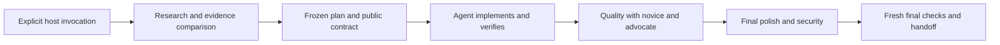

# Repository architecture

Just Build is a host-driven skill with deterministic local controls. The hosting agent performs research, decisions, coding and review; Python helpers validate/record evidence and execute bounded checks. This distinction is central to the project.

| Component | Responsibility |
|---|---|
| Host `SKILL.md`, `references/host.md` | Invocation, available tools and host-specific routing |
| `just_build.py`, `idea_validation.py` | Bounded discovery/scaffolding, idea-pool validation and corroborated selection |
| `run_tracker.py`, `usability_review.py`, `run_diagnostics.py` | Ordered lifecycle, frozen acceptance, current-source review/experience gates, retained usability attempts and read-only recovery guidance |
| `behavior_contract.py`, `api_contract.py`, `contract_assertions.py` | Project-external public CLI/loopback API assertions, strict typed JSON and CLI input-byte preservation |
| `host_safety.py`, `process_runner.py`, `security_audit.py` | File/process bounds, ordinary cleanup and passive heuristic scanning |
| Root `tools/` | Repository policy, shared-file sync, release building/verification and example evaluation |
| Root `examples/`, `docs/` | Curated actual trial deliverables, provenance and evaluation limits |

The two host packages are independently installable. Shared files are maintained canonically in the Codex folder and synchronized explicitly; three host-specific paths are excluded. Installed packages never import root maintenance tools or their development dependency.

Novice/advocate gating is required for new enhanced projects and opt-in for continuations. Historic schema-v2 ledgers retain their compatibility behavior. No silent migration changes old evidence. Changes to source or declared delivered artifacts invalidate current approvals; late repair conservatively repeats reviews and final checks while preserving frozen acceptance.

Retrieved text and project content are data, not permissions. Subprocesses retain host privileges: supervision is not an OS sandbox. Editable ledgers and declared reviewer identities are cooperative evidence, not proof of truth. Static scans and simulated users are limited tools, not security/accessibility certification or human research. See [SECURITY.md](../SECURITY.md) and [EVALUATION.md](EVALUATION.md).

CI validates repository policy, both host source suites and generated examples before packaging. Manual release verification checks an exact reviewed commit and repeats the matrix. Release verification compares bounded archive contents to a trusted checkout; checksums alone do not authenticate an unknown download. No workflow creates releases or writes repository contents.
